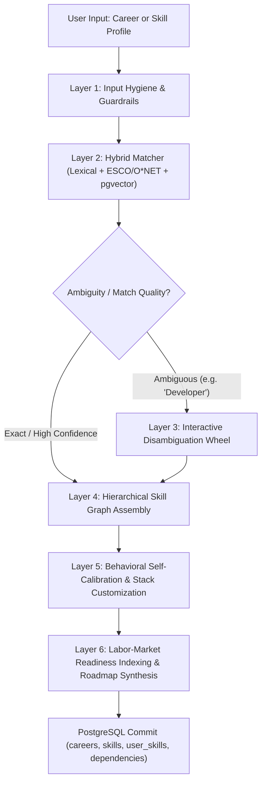

# Career Beacon: Next-Gen Onboarding Architecture & System Blueprint

## Executive Overview

Most AI career platforms feel like **"AI-slop"** because they reduce career guidance to a generic text box that prompts an LLM to hallucinate a flat list of 8 random buzzwords with arbitrary sliders. 

Real career development is grounded in **labor economics, dependency graphs, and cognitive calibration**. 

This document outlines the end-to-end reimagining of the **Career Beacon Onboarding System**, transforming it from a superficial 2-step form into a **scientifically sound, labor-market-backed Career Intelligence Engine**.

---

## 1. Architectural Comparison: Current vs. Reimagined

| Dimension | Current Implementation | Reimagined Career Intelligence Engine |
| :--- | :--- | :--- |
| **Input Ingestion** | Raw string search; fragile semantic similarity. | **Hybrid Semantic-Lexical Disambiguator** with client-side entropy & guardrails. |
| **Career Taxonomies** | Ad-hoc user strings or generic LLM titles. | **ESCO & O*NET Aligned** with standardized occupation codes & market demand. |
| **Discovery Modes** | Single path: Target career name only. | **Dual-Mode Engine**: Target Career Mode OR Transition Mode (*"What can I do with my existing skills?"*). |
| **Skill Structure** | Flat array of 8 isolated items. | **Directed Acyclic Graph (DAG)**: Foundational → Core Domain → Specialized Tooling. |
| **Skill Assessment** | Arbitrary self-rating (20 / 50 / 80). | **Evidence-Anchored Behavioral Calibration** with optional 60-second diagnostic probes. |
| **Personalization** | Static list generated by AI; zero user control. | **Interactive Stack Selection**: Add, remove, swap stacks (e.g. React vs Vue, FastAPI vs Django). |
| **Readiness Metric** | Simple arithmetic mean (`avgProgress %`). | **Weighted Labor-Readiness Index**: Essential vs. Optional skills, with time-to-competency projection. |

---

## 2. Core Pillars of the New Onboarding System



---

## 3. Detailed Architectural Layers

### Layer 1: Input Hygiene & Token Safeguarding (Edge & FastAPI)
Prevents waste of LLM tokens, rejects malicious/gibberish inputs, and guides the user toward actionable career queries:
1. **Entropy & Heuristic Filter (Client & Server):**
   - Rejects single words with no vowel structure or excessive repeated characters (`"asdfasdf"`, `"qqqqqq"`).
   - Enforces length bounds (3 to 60 characters).
2. **Intent Guardrail:**
   - Detects queries that are hobbies, degrees, or vague wishes (`"make money"`, `"computer science degree"`) and nudges the user: *"Did you mean a specific role like Software Engineer or Systems Analyst?"*
3. **Domain Vocabulary Normalization:**
   - Strips conversational clutter (`"I want to become a..."`, `"Looking for jobs in..."`) using regex before reaching embedding models.

### Layer 2 & 3: The Hybrid Matcher & Disambiguation Engine
Solves the **Vector Collusion Trap** where *"Frontend Developer"* and *"Backend Developer"* evaluate to ~0.87 similarity.

```
Incoming Query: "Frontend Developer"
       │
       ├─► 1. Lexical Substring & Trigram Match (pg_trgm)
       │      Detects explicit polarity keywords: ['frontend', 'backend', 'devops', 'data', 'mobile']
       │
       ├─► 2. ESCO & O*NET Vector Index (all-MiniLM-L6-v2)
       │      Matches against official European/US standard occupation titles and codes.
       │
       └─► 3. Hybrid Re-Ranker:
              Final_Score = 0.6 * Lexical_Exactness + 0.4 * Vector_Cosine
```

- **Interactive Disambiguation Wheel:**
  If a user types a broad term like `"Data"`, the engine does NOT guess. It presents an instant branching card:
  - *Data Analyst* (BI, SQL, Tableau, Statistics)
  - *Data Engineer* (Pipelines, Spark, Airflow, Data Warehouses)
  - *Data Scientist / ML Engineer* (Python, Modeling, Deep Learning, MLOps)

### Layer 4: Taxonomy-Backed Hierarchical Skill Graph (DAG)
Instead of forcing 8 arbitrary skills, the system constructs a **3-Tier Directed Acyclic Graph**:

```
┌────────────────────────────────────────────────────────────────────────┐
│ TIER 1: FOUNDATIONAL PREREQUISITES (Weight: 25%)                      │
│ Universal fundamentals required before building domain features.       │
│ e.g. Version Control (Git), HTTP/REST Protocols, Core Programming Syntax│
└───────────────────────────────────┬────────────────────────────────────┘
                                    │ Unlocks
┌───────────────────────────────────▼────────────────────────────────────┐
│ TIER 2: CORE WORKHORSE COMPETENCIES (Weight: 50%)                      │
│ The non-negotiable daily skills required by 90%+ of job postings.     │
│ e.g. React.js, State Management, Relational DBs (PostgreSQL)           │
└───────────────────────────────────┬────────────────────────────────────┘
                                    │ Unlocks
┌───────────────────────────────────▼────────────────────────────────────┐
│ TIER 3: SPECIALIZED & TOOLING EXTENSIONS (Weight: 25%)                 │
│ Differentiators that transition learners from Junior to Mid-level.    │
│ e.g. CI/CD Pipelines, Docker Containers, Performance Profiling        │
└────────────────────────────────────────────────────────────────────────┘
```

- **Sourced from ESCO's Essential vs. Optional Skills Schema**, supplemented with modern tech stacks via Groq/Gemini when emerging frameworks (e.g., Supabase, Next.js App Router) are involved.

### Layer 5: Calibrated Behavioral Assessment & User Agency
Overcomes **Dunning-Kruger** and allows personal stack customization:

1. **Concrete Behavioral Anchors (Replacing 20 / 50 / 80):**
   - **Novice (20):** *"I understand concepts and syntax from tutorials, but cannot build or debug standalone projects independently."*
   - **Intermediate (50):** *"I have built complete projects, work with documentation, and solve production bugs without hand-holding."*
   - **Advanced (80):** *"I design architectures, review code, optimize performance, and understand security trade-offs."*
2. **User Agency (Stack Customization):**
   - Users can delete skills that don't match their environment (e.g., swapping *Angular* for *React*).
   - Users can add their custom niche skills with instant autocompletion.
   - Users can toggle their stack specialization.

### Layer 6: Dynamic Readiness & Career Velocity Metrics
Instead of an uninformative "Average: 45%", the system produces actionable career diagnostics:
- **Core Coverage:** 3 of 4 essential core skills met.
- **Estimated Learning Velocity:** ~25 targeted micro-lessons (~4 weeks at 1 lesson/day) to hit entry-level candidate benchmark.
- **Immediate Next Best Action:** Points to the exact single highest-leverage foundational skill gap to tackle first.

---

## 4. Implementation Phasing Strategy

```
Phase 1: Guardrails & Disambiguation Engine
├── Input validation & entropy filters
├── Lexical + Trigram disambiguation in PostgreSQL
└── Rejection of vector collusion (Frontend vs Backend)

Phase 2: Hierarchical 3-Tier Skill Graph & Taxonomy Alignment
├── ESCO/O*NET mapping table in Supabase
├── Tier-structured AI fallback prompt
└── Prerequisite relationships in recommendation_service

Phase 3: Calibrated Onboarding UI & Stack Customization
├── Behavioral rubric selector (Novice/Intermediate/Advanced)
├── Add/Remove/Swap skill buttons in Step 2
└── Tiered visual card layout on Dashboard
```
